  

  
  
  
  

---

## 🫡 сначала честно

> Всё, что было написано в этом профиле раньше, — **почти фейк**. Никакой я не «эксперт по Web3» и не «senior с восемью годами опыта».
> Я **вайбкодер**: придумываю штуку, сажусь её делать, объясняю ИИ чего хочу — и не успокаиваюсь, пока оно не заработает.
> Пишу **по кайфу**, а не для резюме. Если код выглядит странно, но работает — значит, так и задумано. Наверное.

 

## ⚙️ как это у меня устроено

<table>
<tr>
<td width="50%" valign="top">

**⚡ вдохновение**
Идея приходит внезапно — в очереди, в душе, посреди другой задачи. Записываю, чтобы не потерять. Через неделю репозиторий уже существует.

**🧪 метод тыка**
Половина этих репозиториев — эксперименты. Вторая половина — эксперименты, которые внезапно понадобились людям.

</td>
<td width="50%" valign="top">

**🔥 дедлайн = я сам**
Заказчиков нет, есть только «ну это же прикольно». Поэтому и работаю до тех пор, пока не станет красиво.

**☕ условия**
Кофе, музыка и полная тишина в чатах. Без этого код не компилируется — проверено.

</td>
</tr>
</table>

---

## 🧩 что реально живёт в репозиториях

<table>
  <tr>
    <td align="center" width="64">🎯</td>
    <td>
      <b><a href="https://github.com/aeshtlv/Flushot">Flushot</a></b> — скриншоты для Windows 10/11: 
      выделил область — получил снимок в аккуратной рамке, с пометками и распознаванием текста. 
      Electron · TypeScript · MIT · <a href="https://flushot.ink/">flushot.ink</a>
    </td>
  </tr>
  <tr>
    <td align="center">💳</td>
    <td>
      <b><a href="https://github.com/aeshtlv/shftsecurebot">shftsecure</a></b> — Telegram-бот-витрина для Remnawave: 
      подписки за Telegram Stars, промокоды, рефералка, автопродление и админка прямо в боте. 
      Python · aiogram · PostgreSQL
    </td>
  </tr>
  <tr>
    <td align="center">🎫</td>
    <td>
      <b><a href="https://github.com/aeshtlv/supportticketbot">supportticketbot</a></b> — поддержка без панелей: 
      каждый тикет = топик в админ-группе, ответы летят пользователю в личку. 
      Python · Telegram Bot API · Forum Topics
    </td>
  </tr>
  <tr>
    <td align="center">🎁</td>
    <td>
      <b><a href="https://github.com/aeshtlv/GiftTinder">GiftTinder</a></b> — «тиндер» для Telegram Gifts: 
      свайпаешь подарки, ловишь мэтч, открывается чат. Mini App целиком. 
      Python · Telegram WebApp · JS
    </td>
  </tr>
  <tr>
    <td align="center">📊</td>
    <td>
      <b><a href="https://github.com/aeshtlv/GiftPortfolioTrackerPro">GiftPortfolioTrackerPro</a></b> — портфель подарков: 
      стоимость, графики, P&amp;L и уведомления, когда рынок решил дёрнуться. 
      JavaScript · Telegram WebApp
    </td>
  </tr>
</table>

⚠️ остальные репозитории — тоже мои, просто они ещё не решили, чем хотят быть.

---

## 🛠 стек, который действительно трогаю

  

  <b>Python</b> · FastAPI · aiogram 3 · Telethon · <b>TypeScript</b> · Electron · Node.js · SQLite / PostgreSQL · Docker · GitHub Actions

Всё остальное — по документации, по наитию и по вопросам в чат. Это тоже способ.

---

## 🧠 как это выглядит изнутри

  

Кидаю запрос — и дальше сигнал сам бежит по связям, пока не вернётся с чем-нибудь работающим. Иногда возвращается не туда, но это уже детали.

---

## 📮 если что

Есть идея, баг или просто хочешь поболтать о коде — пиши.

 

