  

 

**пишу на Python и TypeScript** 
телеграм-боты · десктопные приложения · мелкие утилиты 
не эксперт и не senior — просто делаю то, что хочется

 

  

 

**проекты**

- [**Flushot**](https://github.com/aeshtlv/Flushot) — скриншоты на Windows: выделил область, снимок готов
- [**remnabuy**](https://github.com/aeshtlv/remnabuy) — подписки на Remnawave: Stars, СБП, промокоды, рефералы
- [**supportticketbot**](https://github.com/aeshtlv/supportticketbot) — поддержка через топики в телеграм-группе
- [**GiftTinder**](https://github.com/aeshtlv/GiftTinder) — свайпы по подаркам, Telegram Mini App

 

